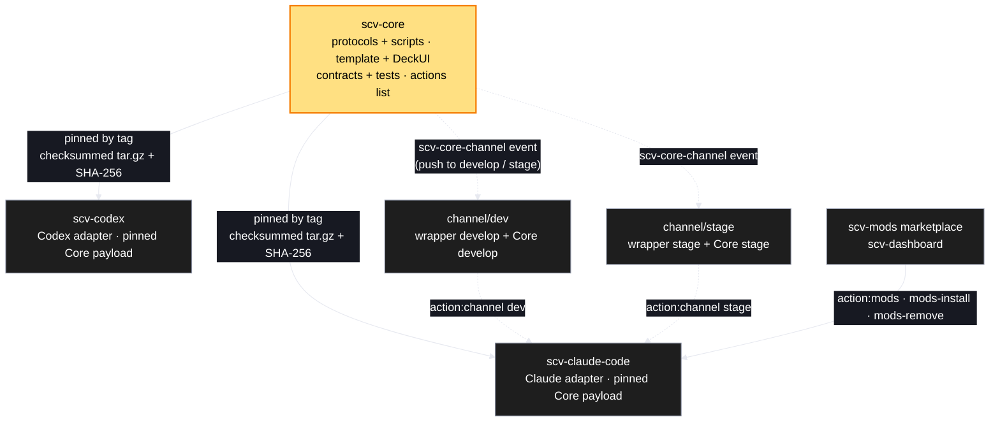
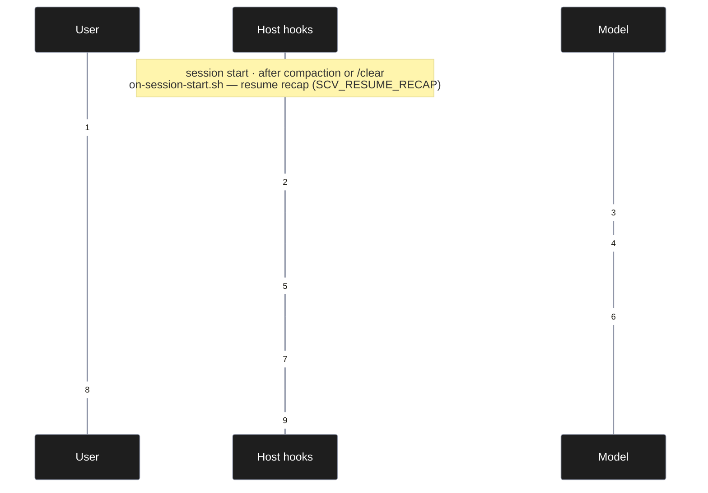

# Architecture

SCV is split into one behavioral source of truth and thin host adapters.

Released wrappers carry one pinned Core. The `channel/*` branches are separate
builds for trying unreleased work (below); they never touch `develop`, `stage`,
`main`, or the release chain.

## Ownership boundary

Core owns behavior that must remain identical across hosts:

- the 20-action catalog (`core/actions.json`) and the 14 core-owned
  implementations;
- planning, work, reporting, regression, workspace, handoff, and Deck behavior;
- the hydrated `scv/` project layout and `SCV.md` state schema;
- shared migration and conflict-detection semantics;
- shared tests and DeckUI.

Adapters own behavior that cannot be host-neutral:

- plugin manifests and marketplace metadata;
- action discovery files and invocation syntax;
- translating host arguments into the Core entrypoint contract;
- installation/update mechanics, including mods (`action:mods`,
  `mods-install`, `mods-remove`) and channel swaps (`action:channel`);
- host model policy and model metadata;
- optional host state-pointer files and their explicit migration UX.

`update` and `set-models` remain in the shared action catalog so both products
present the same capability surface, but their entrypoints are adapter-owned.

## Build-time projection, local runtime

Core protocols contain only canonical tokens:

- `action:<id>` for action references;
- `{{SCV_ARGS}}` for host arguments;
- the profile root-variable token for installed-path references.

The wrapper validates its line-oriented profile and materializes those tokens
while vendoring a pinned release. The installed plugin runs entirely from the
vendored payload; it does not fetch Core at runtime.

## Immutable source, external Deck runtime

The vendored `core/DeckUI` tree is immutable source. `deck-runtime.sh` copies
that source into a user cache namespaced by `source_payload_sha256` before Deck
execution. Both wrappers therefore resolve the same Core release to the same
cache while their plugin trees remain verifiable and replaceable.

Only mutable runtime entries are migrated from a legacy in-plugin DeckUI:

- root and deckdoc `node_modules`;
- `dist-deck`;
- non-sample generated `src/deck/decks/<slug>/deck.json`.

Migration is additive and collision-safe. It never deletes the legacy source,
never follows generated-deck links, and never replaces a different cached
value.

Strict migration is the default. Before copying, Core preflights every eligible
legacy entry and its destination. A different pre-existing destination is a
collision; Core copies no legacy runtime entry, never overwrites the
destination, and leaves the source unchanged.

For a persistent legacy source, callers may explicitly select
`migrate --from LEGACY_DECKUI --reuse-existing`. If preflight finds even one
different pre-existing destination, the current cache becomes authoritative
for the whole migration and Core copies nothing from that legacy source,
including entries whose destinations are equal or missing. If preflight finds
no mismatch, the operation keeps the normal additive behavior. A collision
that appears after preflight always fails closed; it never switches a running
transaction into reuse mode.

This opt-in is safe only while the legacy source remains available after the
operation. Persistent Claude live DeckUI and Codex plugin-root legacy snapshots
may use it. Recovery from an existing vendor that a wrapper will remove after
a successful swap is ephemeral and must remain strict, otherwise an
authoritative-reuse decision could discard its only runtime data.

Every mutating cache operation is descriptor-relative. Core opens the cache
base from the filesystem root one component at a time with no-follow
semantics, then pins the payload namespace and runtime target by device,
inode, and type. Lock candidates, stale quarantine, staging, migration,
installation, and cleanup use only those descriptors and atomic no-replace
renames. If any visible ancestor, namespace, target, lock, or owner is replaced
mid-operation, Core fails closed and does not follow the replacement.

## State-index transition

`scv/SCV.md` is the only canonical state index. A profile may declare
`CLAUDE.md|CODEX.md` as legacy indexes. Resolution follows these rules:

1. Use `SCV.md` when it exists.
2. Otherwise, read a single non-pointer legacy index.
3. Treat the exact `SCV:HOST-POINTER target=SCV.md` marker as a Core
   compatibility pointer, not a second state copy.
4. If two independent indexes exist and differ byte-for-byte, report a
   conflict. Read-only help remains diagnostic; mutating sync exits before
   changing files.
5. Explicit migration seeds `SCV.md` with no-replace semantics, preserves each
   legacy file in a recoverable backup, then replaces only existing legacy
   files with the same host-neutral pointer.
6. A conflict remains hydrated when readable state and `PROMOTE.md` exist, but
   every mutating operation still fails closed.

Help never triggers sync or migration. Dry-run sync reports the pending
migration without modifying the working tree. Both wrappers delegate this
entire contract to `core/scripts/state-index.sh`.

## Every turn

Five host hooks carry SCV into ordinary conversation. Core ships them as
templates under `core/template/hooks/`; the wrapper registers them. Codex has no
session-start hook, so the resume recap does not run there.

- **Routing and diagnosis** — free conversation goes to the help action, with a
  short project diagnosis so the model starts from the real state
  (`SCV_ALWAYS_ON`).
- **Per-model prompting** — the request is compared item by item with the
  model's requirement checklist (quoted verbatim from its official guide) and
  registered; the answer opens with one "understood as" line and quotes the
  rewritten request (`SCV_MODEL_PROMPTING`).
- **Show the real thing** — when a turn changes the deliverable, the first time
  it runs the model runs the smallest real thing, shows the actual output, and
  asks continue or fix; a turn that changes nothing says so
  (`SCV_SHOW_REAL`, [contract](../core/contracts/show-real.md)). The real-use
  report `core/scripts/show-real-report.sh` measures it over past sessions: its
  rules settle most turns, and the turns they cannot settle go to the host's
  judge command (`SCV_JUDGE_COMMAND`, host profile).
- **Dreams** — after compaction or `/clear` and on the first human message of a
  new day, a background run looks back over past session records and the
  archive, and writes an HTML report under `scv/dreams/`: human queries per plan
  and how to write better requests; the next turn carries one summary line
  (`SCV_DREAMS`, `SCV_DREAMS_JUDGE`, `action:dreams`). It never changes its
  inputs.
- **Resume recap** — after compaction, `/clear`, or a resume, the session-start
  hook re-injects active plans, recent decisions, open items, and the active
  conversation (`SCV_RESUME_RECAP`).

## Release channels

`action:channel` swaps the installed SCV between three channels, so unreleased
work can be tried without a production release
([protocol](../core/protocols/channel.md)):

| Channel | Wrapper branch | Holds |
|---|---|---|
| dev | `channel/dev` | the wrapper's develop + Core's develop |
| stage | `channel/stage` | the wrapper's stage + Core's stage |
| prod | none (default branch) | the latest release |

A push to Core's `develop` or `stage` sends a `scv-core-channel` event; each
wrapper's channel sync vendors that Core commit onto its own branch, stamps a
channel version (the next patch plus `-dev.<commit>` or `-stage.<commit>`, so a
swap always installs a fresh copy), validates, and force-pushes `channel/*`.
The swap itself is wrapper-owned: check the branch exists, remove the
marketplace, add it again at the channel's branch, install, and put the old
channel back if a step after the removal fails. The pure part — branch for a
channel, swap steps, channel version — is `core/scripts/lib/channel.sh`.

## Mods

Mods are plugins from a separate marketplace (`wookiya1364/scv-mods`) that sit
beside SCV, such as scv-dashboard, an SCV pane in the desktop app.
`action:mods` updates every installed mod and lists them; `mods-install` and
`mods-remove` pick one. All three are wrapper-owned because plugin commands are
host commands ([protocol](../core/protocols/mods.md)). How to mirror the pane
to another computer is in the
[scv-mods README](https://github.com/wookiya1364/scv-mods#readme).

## Enforcement layers

Three checks defend the workflow. They are easy to mistake for one another, so
the difference is stated once here: they run at different times, read different
evidence, and answer different questions.

| Layer | Runs | Reads | Enforces |
|---|---|---|---|
| Workspace guard — `core/template/hooks/guard.sh` | at runtime, on a tool call | the host's tool-call payload | an SCV action ran in this session |
| Provenance gate — `core/scripts/check-provenance.sh` | at merge time, on a pull request | the resulting diff | this change came from a plan |
| Vendor gate — `core/scripts/check-vendor-provenance.sh` | at merge time, on a pull request | the resulting diff | who moved the pinned Core |

The guard is a `PreToolUse` hook. It denies creating a plan file under
`<scv_root>/promote/` without a receipt, and writing outside the workflow
directory without a receipt. A receipt is minted when the host itself reports
that an SCV action is running — the model cannot fabricate a host event, which
is what makes the receipt worth keying on, unlike any marker written into the
project. Core ships the executable template and
[`core/contracts/guard.md`](../core/contracts/guard.md); registration is
wrapper-owned, the same boundary as `update` and `set-models`, so the script
names no host and no tool. It fails open on an empty payload and on a machine
with no JSON reader; an unusable receipt store is the one failure that closes,
denying every non-exempt write for the session. It is inert wherever SCV is not
adopted.

The provenance gate asks a different question. A pull request that changes code
must add an archived plan at `scv/archive/<slug>/PLAN.md`, whose frontmatter is
then validated against the PLAN schema. It exempts the release chain (base
`stage` or `main`), the sync bot's `chore/core-*` branches, a
`[no-plan: <reason>]` marker in the title, and a diff that touches nothing but
prose and the workflow directory. An empty `[no-plan]` with no reason is
refused; the reason is the point of the marker.

The vendor gate is that gate's sibling and shares its shape. It denies a pull
request that rewrites `vendor/scv-core/` at any depth on a branch that is not
the sync bot's, unless the title declares `[manual-vendor: <reason>]`. A hand copy
produces a tree that looks correct, but the two paths do not do the same work:
the bot resolves the published release artifact and records both the canonical
and the materialized hash, while a hand copy records whatever the working tree
held. Nothing downstream can tell them apart afterwards.

Neither layer subsumes the other, and the gap runs both ways. The hook only
sees the paths a call names — an editor tool's arguments, and the targets a
patch spells out — so a shell redirect or an in-place edit driven from a command
reaches disk without any rule matching. The gate never sees who produced the change — by the time it
reads a diff, a hand-written plan and a generated one are the same bytes. What
the guard enforces is "an SCV action ran in this session", not "this write
belongs to planned work"; only the merge-time gate enforces the second.

Both gates ship in the Core payload and run from each wrapper's own branch-flow
workflow, against that wrapper's vendored copy.

## Process dashboard

The layers above enforce the process; `core/scripts/metrics.sh` measures it
from the records the process already leaves behind — the archive index, each
archived plan, its conversation file, and the decision log — and prints four
numbers with their coverage: conversation turns per plan, approval-to-archive
lead time, follow-up recurrence (structural signals only: `obsoleted_by` and a
non-empty `supersedes`), and how many plans carry the pure-function section. It
reads only, calls no clock, and reports "none" rather than zero for a plan
without data. It is a per-project gauge, not product telemetry: nothing is
collected across users, and it diagnoses rather than proves.

## Version axes

- `VERSION` tracks behavior and release payload changes.
- `CORE_API` changes only when wrapper integration becomes incompatible.
- `TEMPLATE_VERSION` tracks the hydrated project-template schema independently.

A wrapper may update Core without changing its adapter version, but every
published wrapper release must pin one exact Core version and record its
integrity metadata.
