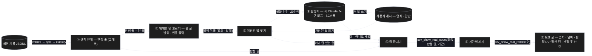
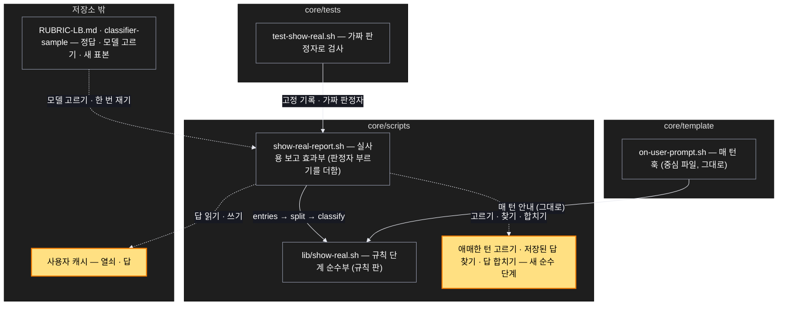

# Architecture — 실사용 보고 판정기 둘 다 — 애매한 턴만 판정자에게, 토큰을 아끼며 늘 켜기

> Two-diagram view of this feature. **Review and edit before `/scv:work`** —
> diagrams are LLM-generated and may have inaccuracies.

## 1. Component data flow

규칙 단계가 판정 줄을 만들고, 애매한 턴만 발췌해 저장된 답을 먼저 찾은 뒤, 남은 턴만 20턴씩 판정자에게 묻는다. 답을 합쳐 센다.



## 2. Position in whole architecture

Where this feature sits in the system. New components highlighted in yellow.

> Source: scv graph (built 2026-10-11)



## 3. Screen mockups

### 실사용 보고 — 규칙 단계 + 애매한 턴만 판정자

```screen
{
  "title": "실사용 보고 판정기 — 둘 다",
  "screenRefs": [
    { "calls": "1", "name": "실사용 보고 명령", "element": "show-real-report.sh --before <날짜..날짜> --after <날짜..날짜>", "when": "사용자가 두 기간을 주고 돌릴 때 — 판정자 단계는 늘 켜짐" }
  ],
  "diagram": [
    { "label": "구성", "code": "flowchart LR\n  A[\"① 규칙 단계\"] --> B[\"② 애매한 턴 고르기\"]\n  B --> C[\"③ 저장된 답 찾기\"]\n  C --> D[\"④ 판정자 (20턴씩)\"]\n  D --> E[\"⑤ 답 합치기\"]\n  C --> E\n  A --> E\n  E --> F[\"⑥ · ⑦ 세기 · 보고 글\"]" },
    { "label": "순서", "code": "sequenceDiagram\n  autonumber\n  participant U as 사용자\n  participant R as ① 규칙 단계\n  participant P as ② · ③ 고르기 · 찾기\n  participant J as ④ 판정자\n  participant M as ⑤ · ⑥ · ⑦ 합치기 · 보고\n  U->>R: 보고 명령 (두 기간)\n  R->>P: 판정 줄 + 턴 줄\n  P->>P: 애매한 턴만 · 저장된 답이 있으면 뺌\n  alt 물을 턴이 있음\n    P->>J: 끝 글 발췌 + 인용 출력 (20턴씩)\n    alt 답 받음\n      J-->>M: 예 · 아니오 배열 (저장)\n    else 명령 없음 · 한도 · 오류 · 깨진 응답\n      J-->>M: 판정 못 한 턴\n    end\n  end\n  M-->>U: 숫자 · 날짜 + 판정자가 정한 턴 · 판정 못 한 턴" }
  ],
  "functions": [
    { "marker": "1", "title": "규칙 단계", "step": "scv_show_real_classify",
      "notes": ["역할: 기록 → 판정 줄 (규칙 판 그대로)", "인용한 확인 창 · 끝 물음표 질문 → 보여 줌, 편집 · 실행 · 인용 없음 → 아님"] },
    { "marker": "2", "title": "애매한 턴 고르기 (새)",
      "notes": ["역할: 판정 줄 + 턴 줄 → 발췌 목록", "고르는 턴: 바뀜 · 결과를 인용해 보임 · 인용한 확인 창 없음 · 끝 글이 물음표 질문 아님", "발췌: 끝 글 마지막 1,500자 + 인용한 출력 몇 줄 — 턴 전체 · 다른 턴 · 사람 메시지는 넣지 않음"] },
    { "marker": "3", "title": "저장된 답 찾기 (새)",
      "notes": ["역할: 발췌 목록 + 저장된 답 → 이미 답 있는 턴 · 물을 턴", "열쇠: 세션 · 시각 · 끝 글 해시 — 끝 글이 바뀌면 다시 묻는다"] },
    { "marker": "4", "title": "판정자 부르기 (새, 효과부)",
      "notes": ["역할: 물을 턴 → 답, 20턴씩 한 번", "도구 없음 · SCV 끔, 예 · 아니오 배열만", "모델: 개발용에서 기준을 넘는 가장 작은 모델(Haiku → Sonnet → Opus)", "새 답을 저장 파일에 쓴다 — 열쇠 · 답만"] },
    { "marker": "5", "title": "답 합치기 (새)",
      "notes": ["역할: 판정 줄 + 답 → 최종 판정 줄 + 판정 못 한 턴 수", "답이 없는 애매한 턴은 규칙 단계 값(보여 주지 않음)"] },
    { "marker": "6", "title": "기간별 세기", "step": "scv_show_real_count",
      "notes": ["그대로"] },
    { "marker": "7", "title": "보고 글", "step": "scv_show_real_render",
      "notes": ["숫자 · 날짜만 — 판정자가 정한 턴 수 · 판정 못 한 턴 수를 더한다"] }
  ],
  "validations": {
    "title": "판정 표 — 어떤 턴이 어디서 정해지나",
    "columns": ["번호", "턴", "정하는 곳", "보여 줌", "검사"],
    "rows": [
      ["1", "결과를 인용한 확인 창 · 끝 물음표 질문", "규칙", "1", "T2"],
      ["1", "첫 편집 뒤 실행 · 인용 · 묻기 없음", "규칙", "0", "T2 · T3"],
      ["2, 4", "결과를 인용해 보인 뒤 물음표 없이 끝남", "판정자", "판정자 답", "T3 · T5"],
      ["3", "이미 답이 저장된 애매한 턴", "저장된 답", "저장된 답", "T6"],
      ["4, 5", "판정자 명령 없음 · 한도 · 오류 · 깨진 응답", "규칙 단계 값", "0 · 판정 못 한 턴", "T7"],
      ["7", "보고 글", "—", "숫자 · 날짜만", "T8"]
    ]
  }
}
```

### 측정 — 정답 고침 · 모델 고르기 · 새 표본 한 번

```screen
{
  "title": "측정 — 저장소 밖 장치(classifier-sample)",
  "diagram": [
    { "label": "순서", "code": "sequenceDiagram\n  autonumber\n  participant F as ① 고정\n  participant G as ② 정답 매기기\n  participant D as ③ 모델 고르기\n  participant V as ④ 한 번 재기\n  F->>F: 정답 고침(글 1,500자 잘림 없앰) · 기준 · 모델 순서를 기준 문서에\n  F->>G: 남은 10-06 · 10-07 바뀐 턴 106 + 개발용 40\n  G-->>D: 개발용 정답\n  D->>D: Haiku → Sonnet → Opus, 기준을 넘는 가장 작은 모델\n  G-->>V: 새 표본 20 · 20 (판정기 완성 전엔 열지 않음)\n  alt 잘못 잡음 0 · 90% 이상 · 입력 평균 2천 토큰 안\n    V-->>F: 보관 · PR (규칙 판과 함께)\n  else 하나라도 못 넘음\n    V-->>F: 멈추고 보고\n  end" }
  ],
  "functions": [
    { "marker": "1", "title": "고정 — 표본을 열기 전에",
      "notes": ["정답 매기기: 요약도 모델 글도 자르지 않음, 질문 · 판정자 설정은 그대로", "기준 · 시드 · 20 · 20 고르기 · 모델 순서를 기준 문서에"] },
    { "marker": "2", "title": "정답 매기기",
      "notes": ["새 표본 후보: 남은 10-06 · 10-07 바뀐 턴 106개에서", "개발용 40턴도 고친 판정으로 다시"] },
    { "marker": "3", "title": "모델 고르기",
      "notes": ["개발용에서만 — 새 표본은 쓰지 않음", "셋 다 못 넘으면 멈추고 보고"] },
    { "marker": "4", "title": "한 번 재기",
      "notes": ["고른 모델로 한 번만", "판정자 입력 토큰은 응답의 사용량 기록으로 잰다"] }
  ],
  "validations": [
    { "marker": "4", "when": "잴 때", "condition": "잘못 잡음", "message": "0", "shownAs": "T13" },
    { "marker": "4", "when": "잴 때", "condition": "보이고 물음 20개 중 잡음", "message": "18개 이상", "shownAs": "T13" },
    { "marker": "4", "when": "잴 때", "condition": "판정자 입력", "message": "애매한 턴당 평균 2천 토큰 안", "shownAs": "T13" },
    { "marker": "3", "when": "모델 고를 때", "condition": "셋 다 기준 못 넘음", "message": "멈추고 보고", "shownAs": "T12" },
    { "marker": "2", "when": "정답 매길 때", "condition": "주간 사용량 한도", "message": "멈추고 보고", "shownAs": "기준 문서" }
  ]
}
```
