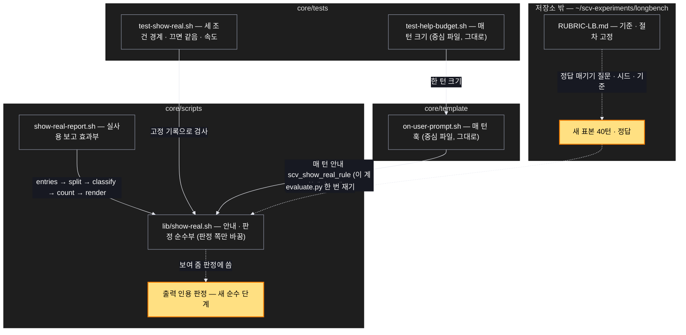

# Architecture — 실사용 보고 판정기를 구조 규칙으로 — 보이고 물었나를 바르게 세기

> Two-diagram view of this feature. **Review and edit before `/scv:work`** —
> diagrams are LLM-generated and may have inaccuracies.

## 1. Component data flow

보고가 세션 기록을 다섯 단계로 흘려 숫자를 내고, 새 '출력 인용 판정'이 턴 판정의 '보여 줌'을 가른다. 저장소 밖 측정 장치는
정답을 먼저 고정한 새 표본으로 판정기를 한 번만 잰다.

```mermaid
%%{init: {'theme':'base', 'themeVariables': {'primaryColor':'#1e1e1e','primaryTextColor':'#fff','primaryBorderColor':'#9096a8','lineColor':'#e7e9f0','secondaryColor':'#2d2d2d','tertiaryColor':'#1e1e1e','background':'#171922','edgeLabelBackground':'#171922'}}}%%
flowchart LR
  Records[("세션 기록 JSONL")] -->|"scv_show_real_entries(기록 줄)"| Entries["① 기록 읽기 — 실행 출력 조각을 더함"]
  Entries -->|"사건 줄 + 실행 출력 조각"| Split["② 턴 나누기 scv_show_real_split"]
  Split -->|"턴의 실행 출력 조각 + 묻는 글 · 창"| Quote["③ 출력 인용 판정 — 새 순수 단계"]
  Quote -->|"줄 · 숫자 그대로: 1 또는 0"| Classify["④ 턴 판정 scv_show_real_classify — 보여 줌 = 가 · 나 · 다"]
  Split -->|"사람 턴 줄"| Classify
  Classify -->|"scv_show_real_count(판정 줄, 기간)"| Count["⑤ 기간별 세기"]
  Count -->|"scv_show_real_render(수)"| Render["⑥ 보고 글 — 숫자 · 날짜만"]
  Pool[("편집 턴 후보 ~80 — 10/9 이후 세션 · 측정 18번 기록")] -->|"judge_sample.py — 가린 판정"| Judge[("판정자 — 새 Claude")]
  Judge -->|"정답으로 보이고 물음 20 · 아님 20 고르기"| Sample[("새 표본 40턴")]
  Sample -->|"evaluate.py — 판정기 완성 뒤 한 번만"| Verdict["⑦ 잘못 잡음 0 · 18/20 이상"]
  Classify -.->|"턴별 보여 줌"| Verdict
```



## 2. Position in whole architecture

Where this feature sits in the system. New components highlighted in yellow.

> Source: scv graph (built 2026-10-11)



## 3. Screen mockups

### 실사용 보고 판정기 — 보여 줌을 세 조건으로

```screen
{
  "title": "실사용 보고 판정기",
  "screenRefs": [
    { "calls": "1", "name": "실사용 보고 명령", "element": "show-real-report.sh --before <날짜..날짜> --after <날짜..날짜>", "when": "사용자가 두 기간을 주고 돌릴 때" }
  ],
  "diagram": [
    { "label": "구성", "code": "flowchart LR\n  R[(\"세션 기록\")] --> A[\"① 기록 읽기\"]\n  A --> B[\"② 턴 나누기\"]\n  B --> Q[\"③ 출력 인용 판정\"]\n  Q --> C[\"④ 턴 판정\"]\n  B --> C\n  C --> D[\"⑤ 기간별 세기\"]\n  D --> E[\"⑥ 보고 글\"]" },
    { "label": "순서", "code": "sequenceDiagram\n  autonumber\n  participant U as 사용자\n  participant A as ① 기록 읽기\n  participant B as ② 턴 나누기\n  participant C as ④ 턴 판정\n  participant Q as ③ 출력 인용 판정\n  participant E as ⑤ · ⑥ 세기 · 글\n  U->>A: 보고 명령 (두 기간)\n  A->>B: 사건 줄 + 실행 출력 조각\n  B->>C: 사람 턴 줄\n  C->>Q: 실행 출력 조각 + 묻는 글 · 창\n  Q-->>C: 줄 · 숫자 그대로 1 또는 0\n  alt 가 · 나 · 다 모두\n    C->>E: 보여 줌 1\n  else 하나라도 없음\n    C->>E: 보여 줌 0\n  end\n  E-->>U: 기간별 숫자 · 날짜만" }
  ],
  "functions": [
    { "marker": "1", "title": "기록 읽기", "step": "scv_show_real_entries",
      "notes": ["역할: 세션 기록 줄을 사건 줄(편집 · 실행 · 기타 · 창 · 글)로", "바꿈: 실행 결과의 내용을 판정에 필요한 만큼 함께 읽는다(지금은 도구 결과 줄을 건너뜀)"] },
    { "marker": "2", "title": "턴 나누기", "step": "scv_show_real_split",
      "notes": ["역할: 사건 줄 → 사람 턴 줄", "그대로"] },
    { "marker": "3", "title": "출력 인용 판정 (새)",
      "notes": ["역할: 실행 출력 조각 + 묻는 글 · 창(또는 바로 앞 글) → 줄 · 숫자가 그대로 들어 있나 1 또는 0", "순수 단계 — 같은 입력이면 같은 답"] },
    { "marker": "4", "title": "턴 판정", "step": "scv_show_real_classify",
      "notes": ["역할: 턴 줄 → 바뀜 · 보여 줌 · 완료 · 수정 요구 · 확인 질문 수", "바꿈: 보여 줌 = (가) 첫 편집 뒤 실행 · (나) 그 실행 뒤 묻기(선택 창 또는 끝 문단 글 질문) · (다) ③이 1", "다른 칸의 뜻은 그대로"] },
    { "marker": "5", "title": "기간별 세기", "step": "scv_show_real_count",
      "notes": ["그대로"] },
    { "marker": "6", "title": "보고 글", "step": "scv_show_real_render",
      "notes": ["그대로 — 숫자 · 날짜만, 기록 문장 · 실행 출력은 내지 않음"] }
  ],
  "validations": {
    "title": "판정 표 — 보여 줌이 되는 조건",
    "columns": ["번호", "조건", "보여 줌", "이유", "검사"],
    "rows": [
      ["4", "첫 편집 뒤 실행이 없음", "0", "결과를 낸 실행이 없음", "T5"],
      ["4", "실행 뒤 묻기가 없음", "0", "알리기만 하고 묻지 않음", "T3"],
      ["4", "묻기가 첫 편집보다 앞", "0", "이번 결과물에 대한 질문이 아님", "T4"],
      ["3, 4", "묻는 글 · 창과 바로 앞 글에 실행 출력의 줄 · 숫자가 없음", "0", "실제 값 없이 물음", "T6"],
      ["3, 4", "세 조건 모두 — 선택 창", "1", "실제 결과를 보이고 물음", "T2"],
      ["3, 4", "세 조건 모두 — 끝 문단 글 질문", "1", "선택 창 없는 호스트", "T7"],
      ["1, 4", "편집 도구 없이 명령으로만 파일을 바꿈", "0 (바뀜도 0)", "지금 판정기와 같은 뜻", "T8"],
      ["6", "보고 글", "—", "숫자 · 날짜만", "T10"]
    ]
  }
}
```

### 새 표본 측정 — 저장소 밖 장치(classifier-sample)

```screen
{
  "title": "새 표본 측정 — 한 번만 재기",
  "diagram": [
    { "label": "순서", "code": "sequenceDiagram\n  autonumber\n  participant P as ① 고정\n  participant B as ② 표본 만들기\n  participant J as ③ 판정자\n  participant V as ④ 한 번 재기\n  P->>P: 기준 · 정답 매기기 절차 · 시드를 기준 문서에\n  P->>B: 10/9 이후 사용자 세션 · 측정 18번 기록\n  B->>J: 편집 턴 후보 ~80\n  J-->>B: 정답 (가린 판정)\n  B->>B: 보이고 물음 20 · 아님 20 고르기\n  B->>V: 새 표본 40턴 (판정기 완성 전엔 열지 않음)\n  alt 잘못 잡음 0 · 18/20 이상 · 시간 2배 안\n    V-->>P: 보관 · PR\n  else 하나라도 못 넘음\n    V-->>P: 멈추고 보고 — 다음 길은 사용자와\n  end" }
  ],
  "functions": [
    { "marker": "1", "title": "고정 — 표본을 열기 전에",
      "notes": ["정답 매기기 질문 · 판정자 설정은 지난번(judge_sample.py)과 같게", "뽑기 시드 · 20 · 20 고르기 규칙 · 통과 기준(잘못 잡음 0 · 18/20 · 시간 2배)을 기준 문서에"] },
    { "marker": "2", "title": "표본 만들기",
      "notes": ["10월 9일 이후 이 저장소 사용자 세션 + 지난 측정 18번의 옮겨 둔 기록에서 편집이 있는 턴", "후보 ~80개 무작위(시드 고정) → 정답 뒤 보이고 물음 20 · 아님 20", "표본 · 정답은 저장소 밖, 내용은 열지 않음"] },
    { "marker": "3", "title": "판정자",
      "notes": ["새 Claude — 도구 없음 · SCV 끔 · 방식을 모름", "호출 ~80번 — 시작 전에 주간 사용량 확인"] },
    { "marker": "4", "title": "한 번 재기",
      "notes": ["판정기를 다 만든 뒤 evaluate.py 로 한 번만", "같은 표본으로 고쳐 다시 재지 않음", "예전 40턴은 참고로만"] }
  ],
  "validations": [
    { "marker": "4", "when": "잴 때", "condition": "잘못 잡음", "message": "0", "shownAs": "T13" },
    { "marker": "4", "when": "잴 때", "condition": "보이고 물음 20개 중 잡음", "message": "18개 이상", "shownAs": "T13" },
    { "marker": "4", "when": "잴 때", "condition": "보고 시간(같은 기록, 맥 bash 3.2)", "message": "지금 판정기의 2배 안", "shownAs": "T12" },
    { "marker": "2", "when": "표본 만들 때", "condition": "보이고 물음이 20개 안 됨", "message": "후보를 늘리고 그 사실을 결과에 적음 — 기준은 그대로", "shownAs": "기준 문서" },
    { "marker": "3", "when": "판정 중", "condition": "주간 사용량 한도", "message": "멈추고 보고", "shownAs": "기준 문서" }
  ]
}
```
