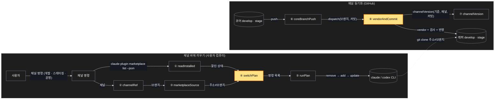
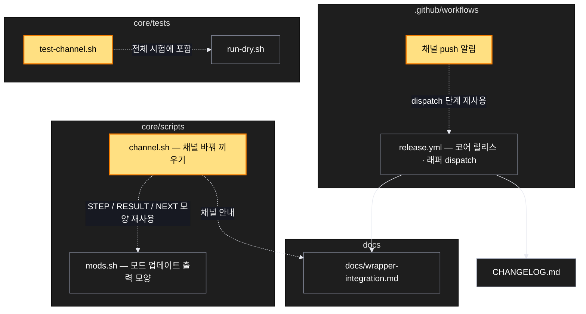

# Architecture — SCV 개발 · 스테이징 채널 — 운영 릴리스 없이 바꿔 끼워 받아 확인

> Two-diagram view of this feature. **Review and edit before `/scv:work`** —
> diagrams are LLM-generated and may have inaccuracies.

## 1. Component data flow

채널 바꿔 끼우기(위)와 코어 → 래퍼 채널 동기화(아래).

## 2. Position in whole architecture

이 기능이 기존 구조 어디에 붙는지. 새 부분은 노란색.

> Source: scv graph (built 2026-10-26)

