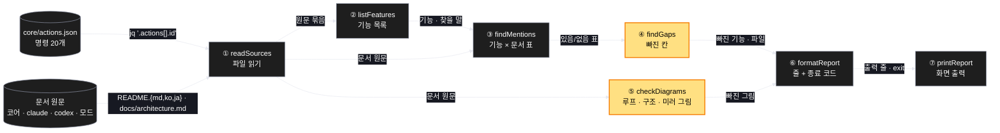
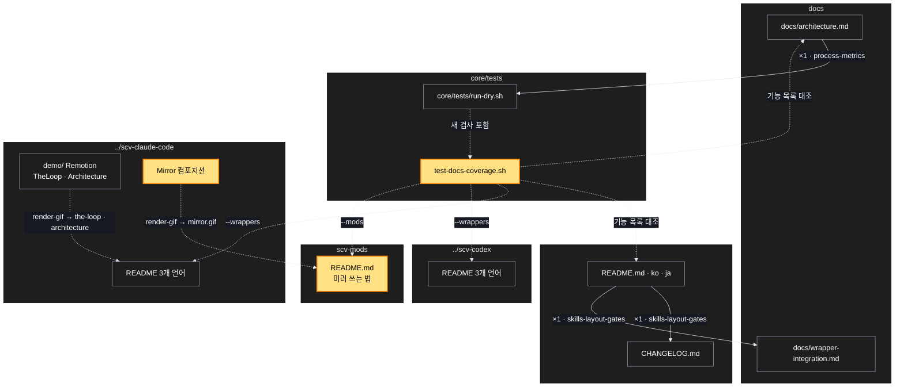

# Architecture — 코어 · 래퍼 · 모드 문서 최신화

> 이 작업을 두 장의 그림으로 본다. **`/scv:work` 전에 검토하고 고쳐라** — 그림은 모델이 그렸으므로 틀린 곳이 있을 수 있다.

## 1. Component data flow

문서 검사가 기능 목록과 네 저장소의 문서를 대조하는 순서. 같은 기능 목록을 README 의 '기능 한눈에' 표도 쓴다.



## 2. Position in whole architecture

이 작업이 닿는 곳. 새로 생기는 것은 노란색, 새 연결은 점선.

> Source: scv graph (built 2026-10-27)



## 3. Screen mockups

### 미러 쓰는 법 (모드 README 에 실을 순서)

```screen
{
  "title": "미러 쓰는 법 — 두 컴퓨터",
  "diagram": [
    { "label": "순서", "code": "sequenceDiagram\n  autonumber\n  participant A as ① 일하는 세션 (컴퓨터 A)\n  participant B as ② 보는 세션 (컴퓨터 B, 그 앱에서 직접 연 세션)\n  A->>A: /scv-dashboard — 주소 출력\n  B->>A: /scv-mirror <주소> — 거울 요청\n  A-->>B: 상태를 보냄 (두 모델은 읽지 않음)\n  Note over B: SCV 칸에 A 의 진행이 보임\n  alt 같은 세션에서 침\n    A-->>A: 자기 자신이라 보낼 곳 없음\n  end\n  B->>B: /scv-mirror stop — 거울 끔" }
  ],
  "functions": [
    { "marker": "1", "title": "일하는 세션", "notes": ["/scv-dashboard 가 이 세션의 주소를 알려 준다", "Remote Control 이 켜져 있으면 그 id 가 주소"] },
    { "marker": "2", "title": "보는 세션", "notes": ["다른 컴퓨터의 데스크톱 앱에서 직접 연 세션이어야 한다", "Remote Control 뷰어(claude.ai · 폰 · 다른 컴퓨터 앱의 원격 보기)는 칸을 그리지 못한다"] }
  ],
  "validations": {
    "title": "주의",
    "columns": ["번호", "조건", "결과"],
    "rows": [
      ["1", "일하는 세션 자신에서 /scv-mirror 를 침", "자기 자신이라 보낼 곳 없음 오류"],
      ["1, 2", "어느 한쪽이 scv-dashboard 0.2.0 미만", "거울이 안 됨 — 둘 다 0.2.0 이상 필요"]
    ]
  }
}
```
