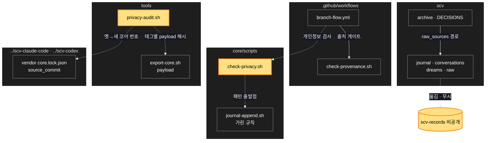

# Architecture — 공개 저장소 개인정보 정리

> 이 작업을 두 장의 그림으로 본다. **`/scv:work` 전에 검토하고 고쳐라** — 그림은 모델이 그렸으므로 틀린 곳이 있을 수 있다.

## 1. Component data flow

원격은 ⑦ 전까지 그대로다. ①~⑥은 이 컴퓨터의 백업 · 작업 사본에서만 일어난다.

```mermaid
%%{init: {'theme':'base', 'themeVariables': {'primaryColor':'#1e1e1e','primaryTextColor':'#fff','primaryBorderColor':'#9096a8','lineColor':'#e7e9f0','secondaryColor':'#2d2d2d','tertiaryColor':'#1e1e1e','background':'#171922','edgeLabelBackground':'#171922'}}}%%
flowchart LR
  Remote[(GitHub 공개 저장소 넷<br>코어 · claude · codex · 모드)]
  Records[(scv-records<br>비공개)]
  Terms[(비공개 목록 파일<br>저장소 밖)]
  S1["① snapshotRepos<br>--mirror 백업 · 전 목록"]
  S2["② buildRules<br>작성자 · 글자 · 경로 · 메시지 줄"]
  S3["③ planRewrite<br>filter-repo 인자"]
  Core["코어 다시 쓰기"]
  S4["④ mapCoreShas<br>옛→새 번호 표"]
  Wr["래퍼 · 모드 다시 쓰기"]
  S5["⑤ scanForLeaks<br>남은 개인정보"]
  S6["⑥ compareInvariants<br>payload · 브랜치 · 태그 · 고정"]
  S7["⑦ pushRewrite<br>규칙 끄기 → 덮어쓰기 → 되돌리기"]

  Remote -->|"git clone --mirror"| S1
  S1 -->|"코어 · 모드 SCV 기록 복사"| Records
  Terms -->|"실명 · 팀 이름"| S2
  S1 -->|"전 목록"| S2
  S2 -->|"규칙 표"| S3
  S3 -->|"filter-repo (코어)"| Core
  Core -->|"commit-map"| S4
  S4 -->|"--replace-text 줄"| Wr
  S3 -->|"filter-repo (래퍼 · 모드)"| Wr
  Core -->|"사본"| S5
  Wr -->|"사본"| S5
  S5 -->|"0건"| S6
  S6 -->|"어긋남 0 + 사용자 확인"| S7
  S7 -->|"git push --force heads · tags"| Remote

  classDef key fill:#FFE082,stroke:#F57C00,stroke-width:2px,color:#000
  class S5,S6,S7 key
```

## 2. Position in whole architecture

이 작업이 닿는 곳. 새로 생기는 것은 노란색, 새 연결은 점선.

> Source: scv graph (built 2026-10-27)

