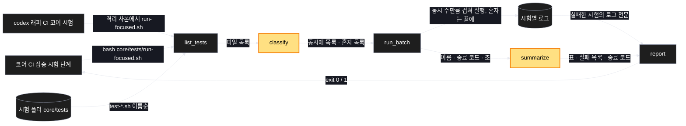
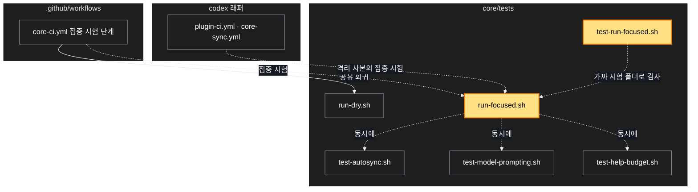

# Architecture — CI 단축 — 코어 시험을 한 작업 안에서 동시에, 속도 검사는 끝에 혼자

> Two-diagram view of this feature. **Review and edit before `/scv:work`** —
> diagrams are LLM-generated and may have inaccuracies.

## 1. Component data flow

시험 실행 도구 안에서 시험 목록이 결과 표가 되기까지.

## 2. Position in whole architecture

Where this feature sits in the system. New components highlighted in yellow.

> Source: scv graph (built 2026-10-28)

