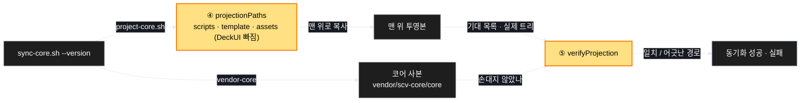
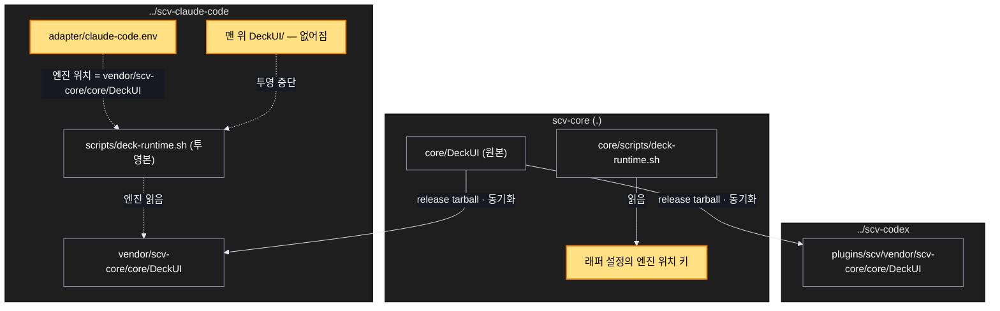

# Architecture — claude 래퍼의 중복 DeckUI 없애기

> Two-diagram view of this feature. **Review and edit before `/scv:work`** —
> diagrams are LLM-generated and may have inaccuracies.

## 1. Component data flow

deck 이 엔진을 찾아 HTML 을 만드는 흐름(바뀐 뒤). 노란 칸이 이번에 바뀌는 곳.

```mermaid
%%{init: {'theme':'base', 'themeVariables': {'primaryColor':'#1e1e1e','primaryTextColor':'#fff','primaryBorderColor':'#9096a8','lineColor':'#e7e9f0','secondaryColor':'#2d2d2d','tertiaryColor':'#1e1e1e','background':'#171922','edgeLabelBackground':'#171922'}}}%%
flowchart LR
  DeckSkill["/scv:deck 스킬"] -->|"scripts/deck.sh <계획 폴더>"| DeckSh["deck.sh"]
  DeckSh -->|"deck-runtime.sh ensure"| Resolve["① resolveDeckSource<br/>엔진 위치 판단"]:::key
  HostProfile["래퍼 설정<br/>adapter/claude-code.env"]:::key -->|"엔진 위치(코어 루트 기준)"| Resolve
  Resolve -->|"설정 없음 → 코어 루트/DeckUI · 있음 → 그 경로"| EngineCore["코어 사본 안 DeckUI<br/>vendor/scv-core/core/DeckUI"]
  EngineCore -->|"엔진 해시로 이름"| Runtime["② ensureRuntime<br/>렌더러 런타임"]
  Runtime -->|"설치 · 재사용"| Cache[("런타임 캐시<br/>SCV_DECK_CACHE_DIR")]
  Runtime -->|"transform.mjs"| Build["③ buildDeck"]
  Build -->|"<계획>.deck.html"| Html[("deck HTML")]
  classDef key fill:#FFE082,stroke:#F57C00,stroke-width:2px,color:#000
```

동기화 쪽(claude 래퍼):

## 2. Position in whole architecture

세 저장소에서 DeckUI 가 어디 있는지 — 바뀐 뒤. 노란 칸이 새로 생기거나 바뀌는 것, 점선이 새 연결.

> Source: scv graph (built 2026-10-29) — 이 계획의 deck 파일들은 그래프에 근거(지난 계획 · 함께 바뀐 기록)가 없어, 저장소 묶음(코어 · ../scv-claude-code · ../scv-codex)만 그래프에서 가져오고 나머지는 PLAN.md 에서 그렸다.

