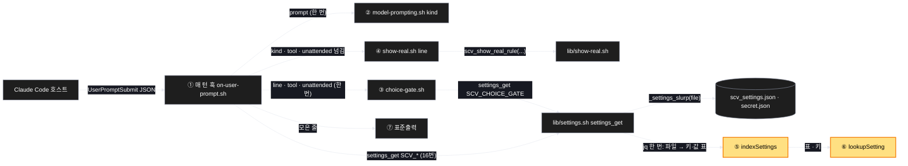
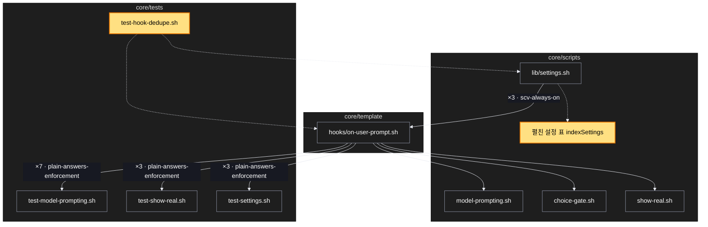

# Architecture — 매 턴 훅 속도 — 같은 판단은 한 번, 설정은 파일당 한 번 읽기

> Two-diagram view of this feature. **Review and edit before `/scv:work`** —
> diagrams are LLM-generated and may have inaccuracies.

## 1. Component data flow

매 턴 훅이 입력을 한 번 읽고, 사람 메시지 판단과 선택 창 상태를 한 번 구해 실체 보여 주기 안내에 넘긴다. 설정은 파일마다 한 번 펼쳐 둔 표에서 찾는다. ①–⑦ 은 계획의 파이프라인 단계 번호다.

## 2. Position in whole architecture

Where this feature sits in the system. New components highlighted in yellow.

> Source: scv graph (built 2026-10-30)

