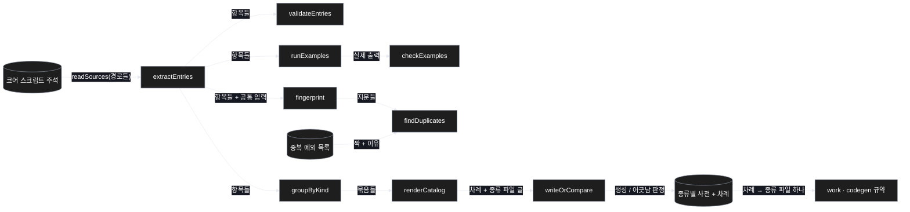
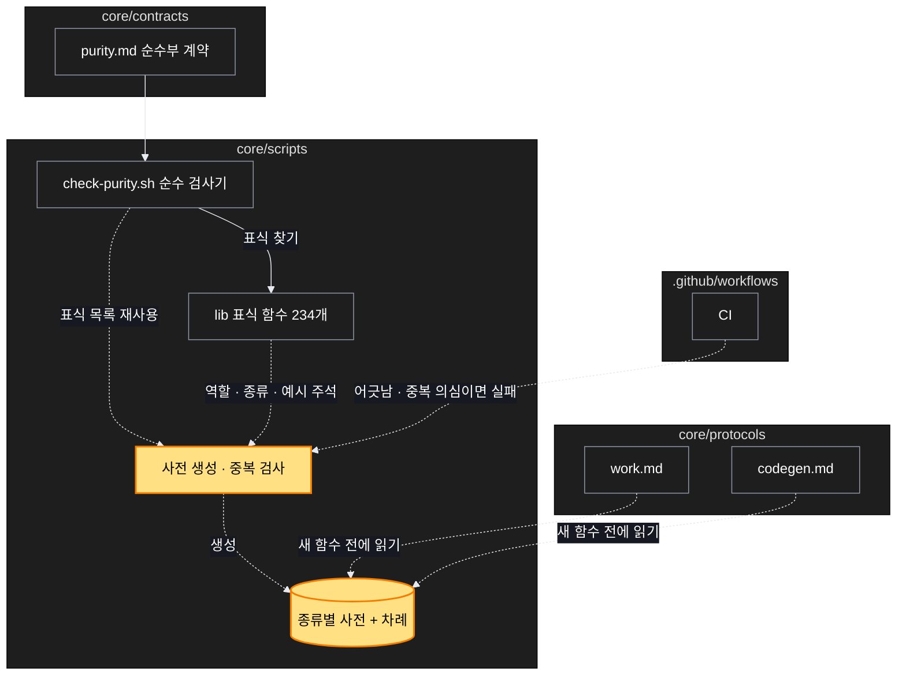

# Architecture — 순수함수 목록 — 만들기 전에 목록에서 찾아 재사용

> Two-diagram view of this feature. **Review and edit before `/scv:work`** —
> diagrams are LLM-generated and may have inaccuracies.

## 1. Component data flow

코드 옆 주석 한 곳에서 시작해 검사와 사전 생성으로 갈라진다.



## 2. Position in whole architecture

새 부분(노랑)은 기존 순수 검사기 곁에 붙고, 구현 규약과 CI 가 결과를 읽는다.

> Source: scv graph (built 2026-11-01)



## 3. Screen mockups

### 사전 생성 · 중복 검사 (화면 없음)

```screen
{
  "title": "순수함수 사전 · 중복 검사",
  "diagram": [
    { "label": "구성", "code": "flowchart LR\n  S[\"주석\"] --> A[\"① 항목 뽑기\"]\n  A --> B[\"② 칸 검사\"]\n  A --> C[\"③ 예시 실행 · 비교\"]\n  A --> D[\"④ 지문 · 중복 판정\"]\n  A --> E[\"⑤ 종류별 묶기 · 사전 쓰기\"]\n  E --> F[(\"⑥ 사전\")]" },
    { "label": "순서", "code": "sequenceDiagram\n  autonumber\n  participant CI\n  participant G as 검사기\n  participant L as 표식 함수들\n  CI->>G: 검사 실행\n  G->>L: 예시 · 공통 입력으로 호출\n  L-->>G: 출력\n  alt 빈 칸 · 틀린 예시 · 중복 의심 · 사전 낡음\n    G-->>CI: 실패 + 이유\n  else 모두 맞음\n    G-->>CI: 통과\n  end" }
  ],
  "functions": [
    { "marker": "1", "title": "항목 뽑기", "step": "extractEntries", "notes": ["받는 값: 스크립트 내용", "돌려주는 값: 이름 · 위치 · 표식 · 역할 · 종류 · 예시"] },
    { "marker": "2", "title": "칸 검사", "step": "validateEntries", "notes": ["역할 · 종류 · 예시 중 빠진 칸, 목록에 없는 종류를 찾음"] },
    { "marker": "3", "title": "예시 실행 · 비교", "step": "checkExamples", "notes": ["적힌 출력과 실제 출력이 다르면 실패"] },
    { "marker": "4", "title": "지문 · 중복 판정", "step": "findDuplicates", "notes": ["같은 개수 인자 함수끼리 공통 입력 출력 비교", "예외 목록은 이유가 있어야 인정"] },
    { "marker": "5", "title": "종류별 묶기 · 사전 쓰기", "step": "renderCatalog", "notes": ["차례 + 종류 파일", "한도 넘는 종류는 세부 종류로 쪼갬"] },
    { "marker": "6", "title": "사전", "step": "writeOrCompare", "notes": ["생성물 — 손으로 고치면 CI 가 어긋남으로 잡음"] }
  ],
  "validations": {
    "title": "실패 · 응답 표",
    "columns": ["번호", "조건", "응답", "메시지"],
    "rows": [
      ["2", "역할 · 종류 · 예시 빠짐", "실패", "함수 이름 + 빠진 칸"],
      ["2", "목록에 없는 종류", "실패", "허용 종류 목록 안내"],
      ["3", "예시 출력이 실제와 다름", "실패", "적힌 값 · 실제 값"],
      ["4", "공통 입력 출력이 전부 같은 짝", "실패", "중복 의심 짝 · 예외 등록법"],
      ["4", "이유 없는 예외", "실패", "이유를 적으라는 안내"],
      ["6", "사전이 코드와 어긋남", "실패", "다시 생성하라는 안내 + 파일 이름"]
    ]
  }
}
```
