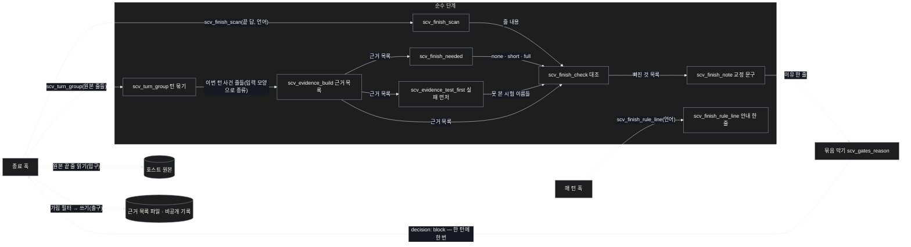
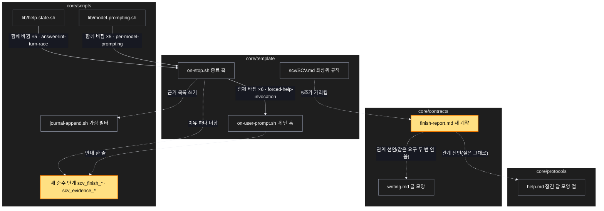

# Architecture — 끝 보고 세 줄 + 근거 목록

> 이 기능의 그림 두 장과 끝 보고 견본 한 장. **`/scv:work` 전에 검토 · 수정** — 그림은 모델이 그려 틀린 곳이 있을 수 있다.

## 1. Component data flow

종료 훅이 원본을 읽어 근거 목록을 만들고, 끝 답의 세 줄과 대조해 빠진 것이 있으면 기존 묶음 막기에 이유 하나로 더한다.



## 2. Position in whole architecture

SCV 안에서 이 기능이 끼는 자리. 새 부분은 노란색.

> Source: scv graph (built 2026-11-05)



## 3. Screen mockups

### 끝 보고 — 일한 턴

```screen
{
  "title": "끝 보고 — 일한 턴",
  "autoMarkers": false,
  "body": [
    { "type": "text", "value": "> 다시 쓴 요청: …" },
    { "type": "header", "title": "결과를 말하는 굵은 주제", "subtitle": "결과 · 풀이 불릿들" },
    { "type": "card", "title": "확인 범위", "marker": "1", "body": [
      { "type": "list", "items": [
        { "label": "확인한 것: 언어 시험 실행 → 14개 통과" },
        { "label": "확인 못 한 것: 실제 세션에서 고쳐 쓰는지는 아직 못 봄" },
        { "label": "제가 대신 정한 것: 걸린 줄은 하나, 60바이트에서 자름" }
      ] }
    ] }
  ],
  "functions": [
    { "marker": "1", "title": "확인 범위 세 줄", "step": "scv_finish_scan",
      "notes": ["도구를 쓴 모든 턴의 끝 보고에 붙음", "'확인한 것'은 근거 목록 항목의 쉬운 이름으로 짚음", "'없음'은 이유가 있어야 인정"] }
  ],
  "states": [
    { "marker": "1", "label": "짧은 턴(SCV 기록 · 질문만)", "body": [
      { "type": "text", "value": "확인 범위: 기록만 함 — 확인 · 결정 없음" }
    ] }
  ],
  "validations": [
    { "marker": "1", "when": "턴 끝(종료 훅)", "condition": "세 줄(짧은 턴은 한 줄) 중 빠진 것", "message": "빠진 줄 이름을 짚는 교정 문구", "shownAs": "한 턴에 한 번 막고 고친 부분만 덧붙임" },
    { "marker": "1", "when": "턴 끝(종료 훅)", "condition": "'없음'에 이유가 없음", "message": "이유를 붙이라는 교정 문구", "shownAs": "같은 막기에 묶임" },
    { "marker": "1", "when": "턴 끝(종료 훅)", "condition": "'확인한 것'이 근거 목록에 없는 실행을 짚음", "message": "짚은 이름을 들어 근거가 없다고 알림", "shownAs": "같은 막기에 묶임" },
    { "marker": "1", "when": "턴 끝(종료 훅)", "condition": "바꾼 시험의 실패를 못 봤는데 안 밝힘", "message": "그 시험 이름을 '확인 못 한 것'에 적으라고 알림", "shownAs": "같은 막기에 묶임" }
  ]
}
```
