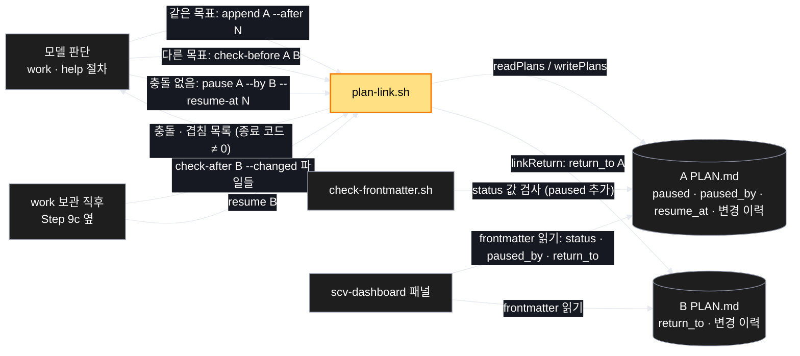
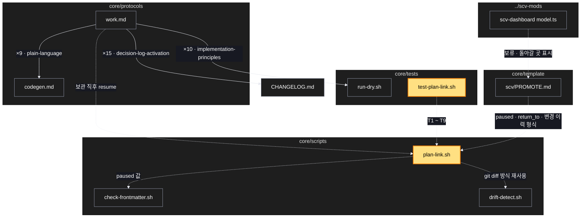

# Architecture — 계획 밖 요구 — 기존 계획에 넣거나, 보류 후 돌아오기

> Two-diagram view of this feature. **Review and edit before `/scv:work`** —
> diagrams are LLM-generated and may have inaccuracies.

## 1. Component data flow

계획 밖 요구가 들어왔을 때 모델의 판단 → `plan-link.sh` → 계획 파일 → 패널로 이어지는 흐름.



## 2. Position in whole architecture

Where this feature sits in the system. New components highlighted in yellow.

> Source: scv graph (built 2026-11-09)



## 3. Screen mockups

### 보류 · 연결 흐름 (plan-link.sh)

```screen
{
  "title": "plan-link.sh — 보류 · 연결 · 복귀",
  "diagram": [
    { "label": "구성", "code": "flowchart LR\n  M[\"① 모델 판단\"] --> P[\"② plan-link.sh\"]\n  P --> A[(\"③ A PLAN.md\")]\n  P --> B[(\"④ B PLAN.md\")]\n  W[\"⑤ work 보관 직후\"] --> P\n  D[\"⑥ 패널\"] --> A\n  D --> B" },
    { "label": "순서", "code": "sequenceDiagram\n  autonumber\n  participant M as ① 모델\n  participant P as ② plan-link.sh\n  participant A as ③ A\n  participant B as ④ B\n  M->>P: check-before A B\n  alt 충돌 있음\n    P-->>M: 충돌 목록 · 종료 코드 ≠ 0\n    M->>M: 선택 창으로 묻기\n  else 충돌 없음\n    M->>P: pause A --by B --resume-at N\n    P->>A: paused · paused_by · resume_at · 이력\n    P->>B: return_to A · 이력\n  end\n  Note over B: B 구현 · 보관\n  M->>P: check-after B --changed 파일들\n  alt 겹침 있음\n    P-->>M: 겹침 목록\n    M->>M: 선택 창으로 묻기\n  end\n  M->>P: resume B\n  P->>A: in_progress · 이력 '재개'" }
  ],
  "functions": [
    { "marker": "1", "title": "모델 판단", "notes": ["진행 중 계획이 있을 때 계획 밖 요구가 오면 같은 목표인지 판단", "판단 결과는 이력 줄의 이유에 남김"] },
    { "marker": "2", "title": "plan-link.sh", "step": "markPause", "notes": ["append · pause · check-before · check-after · resume", "충돌 · 겹침이 있으면 파일을 고치지 않고 종료 코드 ≠ 0"] },
    { "marker": "3", "title": "A PLAN.md", "notes": ["받는 값: paused · paused_by · resume_at · 이력 줄", "끝난 단계의 글은 바뀌지 않음"] },
    { "marker": "4", "title": "B PLAN.md", "step": "linkReturn", "notes": ["받는 값: return_to · 이력 줄"] },
    { "marker": "5", "title": "work 보관 직후", "step": "checkConflictAfter", "notes": ["Step 9c(supersede 전파) 옆에서 return_to 를 보고 실행"] },
    { "marker": "6", "title": "패널", "notes": ["frontmatter 만 읽음 — 쓰지 않음"] }
  ],
  "validations": {
    "title": "실패 · 응답 표",
    "columns": ["번호", "조건", "응답", "기록 · 데이터 영향"],
    "rows": [
      ["2", "B 목표가 A Non-Goals · 남은 단계와 겹침", "충돌 목록 · 종료 코드 ≠ 0", "A · B 변경 없음"],
      ["2", "B 가 바꾼 파일이 A 남은 단계 대상과 겹침", "겹침 목록 · 종료 코드 ≠ 0", "A 변경 없음"]
    ]
  }
}
```

### 패널 — 보류 · 돌아갈 곳 표시

```screen
{
  "title": "scv-dashboard 계획 목록",
  "body": [
    { "type": "card", "title": "A 계획", "body": [
      { "type": "badge", "label": "보류 · <B 제목> 끝나면 재개", "tone": "warn" }
    ]},
    { "type": "card", "title": "B 계획", "body": [
      { "type": "badge", "label": "만드는 중", "tone": "good" },
      { "type": "text", "value": "끝나면 <A 제목>으로 돌아감" }
    ]}
  ],
  "functions": [
    { "marker": "1", "title": "A 계획 카드", "notes": ["status: paused 이면 상태 글을 '보류 · <paused_by 제목> 끝나면 재개'로", "정렬은 in_progress 바로 뒤"] },
    { "marker": "3", "title": "B 계획 카드", "notes": ["return_to 가 있으면 '끝나면 <A 제목>으로 돌아감' 한 줄"] }
  ]
}
```
