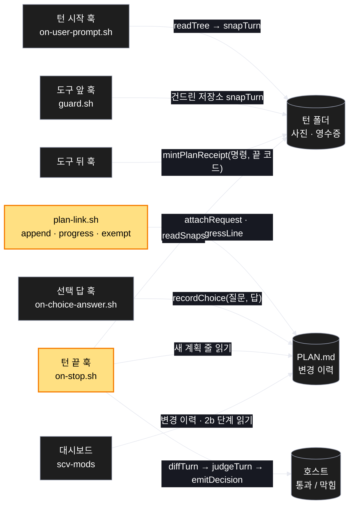
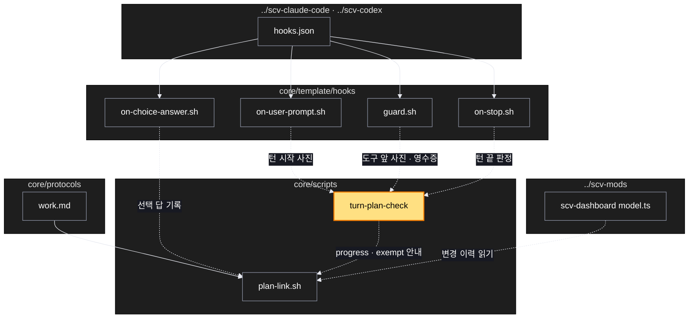

# Architecture — 고친 턴은 계획 기록이 있어야 끝남 · 선택 답은 계획에 바로 · 대시보드에 이력

> Two-diagram view of this feature. **Review and edit before `/scv:work`** —
> diagrams are LLM-generated and may have inaccuracies.

## 1. Component data flow

훅 네 곳이 턴 폴더에 사진 · 영수증을 남기고, 턴 끝 판정이 그것과 계획 파일을 대조한다. 선택 답은 계획 변경 이력으로 바로 가고, 대시보드는 그 이력을 읽는다.



## 2. Position in whole architecture

Where this feature sits in the system. New components highlighted in yellow.

> Source: scv graph (built 2026-11-09)



## 3. Screen mockups

### 턴 끝 판정 (구성 · 순서)

```screen
{
  "title": "턴 끝 판정",
  "screenRefs": [
    { "calls": "4", "name": "Claude Code · Codex 세션", "element": "턴 끝 (Stop 훅)", "when": "모델이 답을 마치고 턴을 끝내려 할 때" },
    { "calls": "5", "name": "Claude Code 세션", "element": "선택 창 답 (PostToolUse AskUserQuestion)", "when": "사용자가 선택 창에 답했을 때" }
  ],
  "diagram": [
    { "label": "구성", "code": "flowchart LR\n  A[\"① 턴 시작 사진\"] --> D[(\"⑥ 턴 폴더\")]\n  B[\"② 영수증\"] --> D\n  C[\"③ plan-link 기록\"] --> P[(\"⑦ PLAN.md 변경 이력\")]\n  E[\"⑤ 선택 답 기록\"] --> P\n  F[\"④ 턴 끝 판정\"] --> D\n  F --> P" },
    { "label": "순서", "code": "sequenceDiagram\n  autonumber\n  participant H as 호스트\n  participant S as ④ 턴 끝 판정\n  participant T as ⑥ 턴 폴더\n  participant P as ⑦ PLAN.md\n  H->>S: Stop\n  S->>T: 시작 사진 · 지금 사진 · 영수증\n  S->>P: 새 계획 줄\n  alt 바뀐 파일 없음\n    S-->>H: 통과\n  else 영수증 + 요청 번호 줄 + 구조 줄\n    S-->>H: 통과\n  else 2번 막혔음\n    S->>P: 계획 기록 없음 한 줄\n    S-->>H: 통과\n  else 그 밖\n    S-->>H: 막힘 + 할 일 한 줄\n  end" }
  ],
  "functions": [
    { "marker": "1", "title": "턴 시작 사진", "step": "snapTurn", "notes": ["git: 변경 파일 해시 + HEAD", "git 아님: 파일 목록 · 시각 · 크기", "작업 공간 설정 목록 저장소 포함"] },
    { "marker": "2", "title": "영수증", "step": "mintPlanReceipt", "notes": ["명령이 bash <절대경로>/plan-link.sh 로 시작하고 성공할 때만", "이름만 적은 명령은 없음"] },
    { "marker": "3", "title": "plan-link 기록", "step": "attachRequest", "notes": ["append · pause · resume · progress · exempt", "줄 끝에 (요청 번호) · 원문 앞부분"] },
    { "marker": "4", "title": "턴 끝 판정", "step": "judgeTurn", "notes": ["바뀐 파일 = 사진 차이 (scv/ 제외, scv/ 밖 .md 포함)", "막는 말은 할 일까지 한 줄"] },
    { "marker": "5", "title": "선택 답 기록", "step": "recordChoice", "notes": ["질문 · 답을 변경 이력에 바로", "codex 는 턴 끝에 기록 파일에서"] }
  ],
  "statesTitle": "판정",
  "validations": {
    "title": "판정 표",
    "columns": ["번호", "조건", "판정", "할 일 (막는 말)", "기록"],
    "rows": [
      ["4", "바뀐 파일 없음", "통과", "—", "없음"],
      ["4", "영수증 + 요청 번호 줄 + 구조 줄", "통과", "—", "계획 줄"],
      ["4", "계획 안 일, 기록 없음", "막힘", "plan-link.sh progress <계획> --step N --note …", "없음"],
      ["4", "계획 밖 일, 기록 없음", "막힘", "plan-link.sh append <계획> --after N --step … --why …", "없음"],
      ["4", "진행 중 계획 없음", "막힘", "계획 만들기 또는 plan-link.sh exempt --kind release|sync", "없음"],
      ["4", "연속 2번 막힘", "통과", "—", "계획 기록 없음 한 줄 (저널 · 계획)"],
      ["2", "plan-link 실패 · 이름만 적음", "영수증 없음", "—", "없음"]
    ]
  }
}
```
