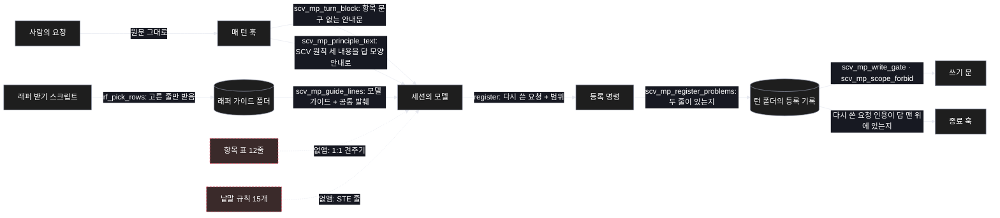
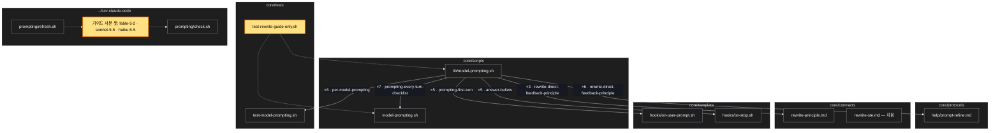

# Architecture — 다시 쓰기는 가이드만

> 이 기능을 두 그림으로 본다. **`/scv:work` 전에 읽고 고칠 것** —
> 그림은 모델이 그렸고 틀릴 수 있다.

## 1. Component data flow

한 턴에서 요청이 다시 쓰이고 등록되는 길. 빠지는 것은 점선으로 그렸다.

## 2. Position in whole architecture

이 기능이 닿는 곳. 새로 생기는 것은 노란색이다.

> Source: scv graph (built 2026-11-10)

