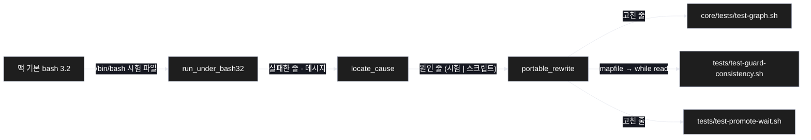
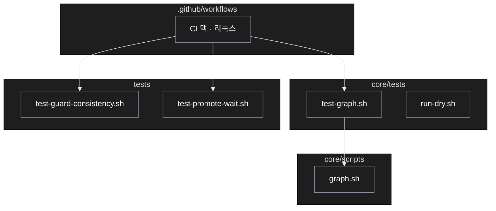

# Architecture — bash 3.2 에서 실패하는 시험 셋 고치기

> 두 그림으로 본 이 계획. **구현 전에 읽고 고칠 것** — 그림은 모델이 그렸다.

## 1. Component data flow



## 2. Position in whole architecture

> Source: scv graph (built 2026-11-11)



## 3. Screen mockups

### 시험 셋

```screen
{
  "title": "bash 3.2 시험 셋",
  "diagram": [
    { "label": "순서", "code": "flowchart LR\n  A[\"① bash 3.2 로 돌림\"] --> B[\"② 원인 가름\"]\n  B --> C[\"③ 같은 뜻으로 고침\"]\n  C --> D[\"④ 두 bash 로 다시 돌림\"]" }
  ],
  "functions": [
    { "marker": "1", "title": "bash 3.2 로 돌림", "step": "run_under_bash32", "notes": ["시험 셋의 실패한 줄과 메시지를 모음"] },
    { "marker": "2", "title": "원인 가름", "step": "locate_cause", "notes": ["시험 파일 탓인지 스크립트 탓인지"] },
    { "marker": "3", "title": "같은 뜻으로 고침", "step": "portable_rewrite", "notes": ["확인된 하나: mapfile 을 while read 로"] },
    { "marker": "4", "title": "두 bash 로 다시 돌림", "notes": ["통과 수가 고치기 전 bash 5 결과보다 줄지 않아야 함"] }
  ],
  "validations": { "title": "통과 기준",
    "columns": ["번호", "조건", "결과"],
    "rows": [
      ["1, 4", "세 시험 · bash 3.2", "종료 코드 0"],
      ["4", "세 시험 · bash 5", "종료 코드 0"],
      ["4", "통과 줄 수", "고치기 전보다 줄지 않음 · 건너뜀 0건"]
    ] }
}
```
