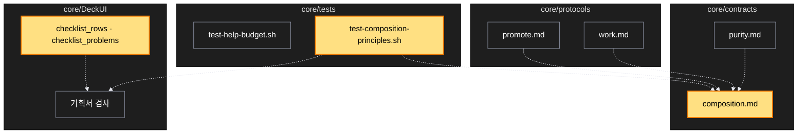

# Architecture — 합성 설계 원칙을 SCV 계약에 넣기

> 두 그림으로 본 이 계획. **구현 전에 읽고 고칠 것** — 그림은 모델이 그렸다.

## 1. Component data flow


## 2. Position in whole architecture

> Source: scv graph (built 2026-11-11)



## 3. Screen mockups

### 계획서의 체크리스트 표

```screen
{
  "title": "계획서 — 순수함수 · 파이프라인 절",
  "body": [
    { "type": "header", "title": "합성 설계 체크리스트", "subtitle": "답마다 근거(파일과 줄) 또는 '해당 없음'과 이유" },
    { "type": "table", "marker": "1", "columns": ["#", "물음", "답", "근거"],
      "rows": [
        ["1", "각 단계가 요소 단위 단항 순수 함수인가", "예", "파일과 줄"],
        ["3", "요소 단위로 먼저 합성한 뒤 순회는 한 번만 하는가", "예", "파일과 줄"],
        ["7", "부수효과가 파이프라인 양 끝에만 있는가", "예", "파일과 줄"],
        ["10", "핫패스는 측정한 뒤에 최적화했는가", "해당 없음", "이유"]
      ] }
  ],
  "functions": [
    { "marker": "1", "title": "체크리스트 표", "step": "checklist_rows", "notes": ["계획을 쓸 때 한 번, 끝낼 때 실제 코드로 다시 한 번 채움"] }
  ],
  "validations": [
    { "marker": "1", "when": "기획서 만들 때", "condition": "체크리스트 표가 없음", "message": "합성 설계 체크리스트가 없습니다", "shownAs": "경고 한 줄(막지 않음)" },
    { "marker": "1", "when": "기획서 만들 때", "condition": "답은 있는데 근거 칸이 빔", "message": "근거가 없는 답: 번호들", "shownAs": "경고 한 줄(막지 않음)" }
  ]
}
```
