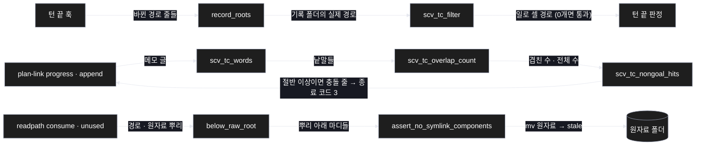
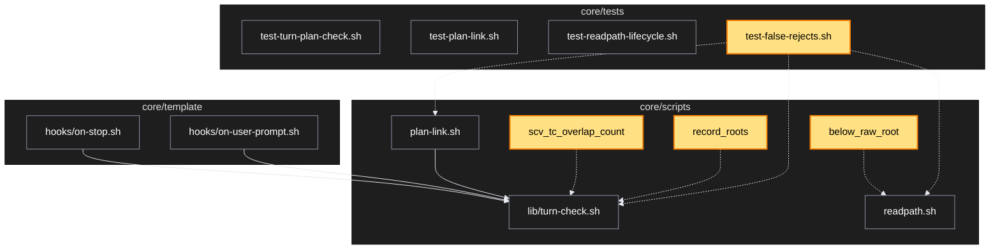

# Architecture — 잘못된 거절 셋 고치기

> 두 그림으로 본 이 계획. **구현 전에 읽고 고칠 것** — 그림은 모델이 그렸다.

## 1. Component data flow

세 고침이 각각 어디를 지나는지.



## 2. Position in whole architecture

> Source: scv graph (built 2026-11-11)



## 3. Screen mockups

### 잘못된 거절 셋

```screen
{
  "title": "잘못된 거절 셋 고치기",
  "diagram": [
    { "label": "구성", "code": "flowchart LR\n  A[\"① 턴 끝 검사\"] --> B[\"② 거름망\"]\n  C[\"③ 진행 메모 검사\"] --> D[\"④ 겹친 수 세기\"]\n  E[\"⑤ 원자료 옮기기\"] --> F[(\"⑥ 원자료 폴더\")]" },
    { "label": "순서", "code": "sequenceDiagram\n  autonumber\n  participant H as 턴 끝 훅\n  participant R as record_roots\n  participant F as scv_tc_filter\n  H->>R: 저장소 뿌리\n  R-->>H: 기록 폴더의 실제 경로\n  H->>F: 바뀐 경로 · 뺄 경로\n  alt 일로 셀 경로 0개\n    F-->>H: 통과\n  else 1개 이상이고 계획 기록 없음\n    F-->>H: 막음\n  end" }
  ],
  "functions": [
    { "marker": "1", "title": "턴 끝 검사", "step": "record_roots", "notes": ["기록 폴더가 연결이면 가리키는 실제 경로를 읽어 거름망에 넘김"] },
    { "marker": "2", "title": "거름망", "step": "scv_tc_filter", "notes": ["받는 값: 바뀐 경로 · 뺄 경로", "돌려주는 값: 일로 셀 경로"] },
    { "marker": "3", "title": "진행 메모 검사", "step": "scv_tc_nongoal_hits", "notes": ["'하지 않음' 항목 낱말의 절반 이상이 메모에 있을 때만 충돌"] },
    { "marker": "4", "title": "겹친 수 세기", "step": "scv_tc_overlap_count", "notes": ["받는 값: 항목 낱말 · 메모 낱말", "돌려주는 값: 겹친 수 · 전체 수"] },
    { "marker": "5", "title": "원자료 옮기기", "step": "assert_no_symlink_components", "notes": ["원자료 뿌리의 연결은 허용, 그 아래 마디의 연결은 거절"] },
    { "marker": "6", "title": "원자료 폴더", "notes": ["옮긴 파일은 stale 아래로, 내용은 그대로"] }
  ],
  "validations": { "title": "막는 경우 · 통과하는 경우",
    "columns": ["번호", "조건", "결과", "메시지", "파일 영향"],
    "rows": [
      ["1, 2", "기록 폴더 안 파일만 바뀜", "통과", "없음", "없음"],
      ["1, 2", "코드 파일이 바뀌고 계획 기록 없음", "막음", "파일 N개가 바뀌었는데 계획 기록이 없다", "없음"],
      ["3, 4", "항목 낱말의 절반 미만 겹침", "통과 (종료 코드 0)", "없음", "이력에 진행 줄 1개"],
      ["3, 4", "항목 낱말의 절반 이상 겹침", "멈춤 (종료 코드 3)", "계획이 하지 않기로 한 일과 겹친다", "없음"],
      ["5", "원자료 뿌리만 연결", "옮김 (종료 코드 0)", "MOVED", "stale 로 이동 · readpath.json 기록"],
      ["5", "뿌리 아래 마디가 연결", "거절 (종료 코드 1)", "refusing symlinked path component", "없음"]
    ] }
}
```
