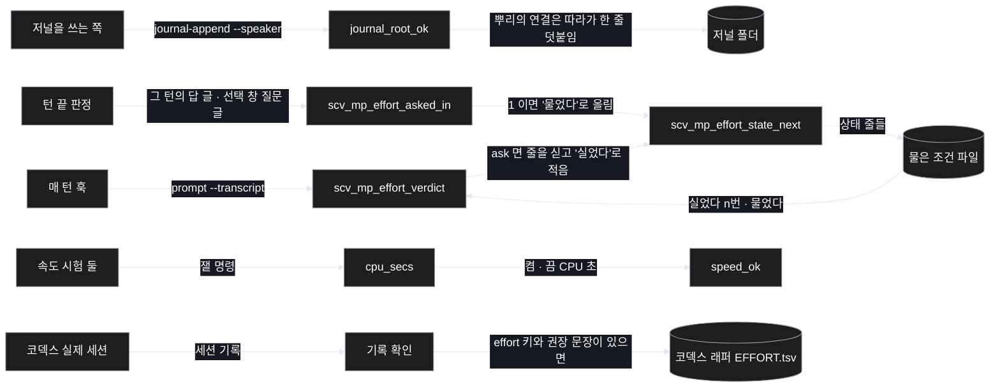
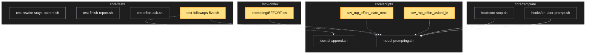

# Architecture — 남은 일 다섯 마무리

> 두 그림으로 본 이 계획. **구현 전에 읽고 고칠 것** — 그림은 모델이 그렸다.

## 1. Component data flow



## 2. Position in whole architecture

> Source: scv graph (built 2026-11-11)



## 3. Screen mockups

### 남은 일 다섯

```screen
{
  "title": "남은 일 다섯 마무리",
  "diagram": [
    { "label": "순서", "code": "flowchart LR\n  A[\"① 저널 뿌리 연결\"] --> B[\"② 안 물은 턴\"]\n  B --> C[\"③ 속도 시험\"]\n  C --> D[\"④ 코덱스 확인\"]\n  D --> E[\"⑤ 코덱스 권장 표\"]" },
    { "label": "② 의 순서", "code": "sequenceDiagram\n  autonumber\n  participant H as 매 턴 훅\n  participant S as 물은 조건 파일\n  participant E as 턴 끝 판정\n  H->>S: 줄을 싣고 '실었다 n번'\n  E->>E: 그 턴의 답에 질문이 있었나\n  alt 있었음\n    E->>S: '물었다'\n  else 없었음\n    E->>S: 그대로 (다음 턴에 다시 실림, 세 번까지)\n  end" }
  ],
  "functions": [
    { "marker": "1", "title": "저널 뿌리 연결", "step": "journal_root_ok", "notes": ["뿌리의 연결은 따라가고, 쓸 파일이 연결이면 거절"] },
    { "marker": "2", "title": "안 물은 턴", "step": "scv_mp_effort_asked_in", "notes": ["받는 값: 답 글 · 선택 창 질문 글 · 권장 값", "돌려주는 값: 1 또는 0"] },
    { "marker": "3", "title": "속도 시험", "step": "cpu_secs", "notes": ["벽시계 대신 그 일에 쓴 CPU 시간 — 먼저 재서 덜 흔들릴 때만 바꿈"] },
    { "marker": "4", "title": "코덱스 확인", "notes": ["설치본을 올려 임시 프로젝트에서 실제 세션을 돌리고 기록으로 확인"] },
    { "marker": "5", "title": "코덱스 권장 표", "notes": ["기록에서 effort 를 읽을 수 있고 가이드에 권장 문장이 있을 때만 넣음"] }
  ],
  "validations": { "title": "통과 기준",
    "columns": ["번호", "조건", "결과"],
    "rows": [
      ["1", "저널 뿌리가 연결", "한 줄을 씀 (종료 코드 0)"],
      ["1", "저널 파일이 연결", "거절 (종료 코드 1)"],
      ["2", "답에 질문이 있었음", "다음 턴 요청 줄 0개"],
      ["2", "답에 질문이 없었음", "다음 턴에 다시 1개, 모두 세 번까지"],
      ["3", "붐비는 기계", "속도 시험 둘 통과"],
      ["3", "큰 기록을 매 턴 처음부터 읽음", "실패"],
      ["5", "기록에서 effort 를 못 읽음", "표를 넣지 않고 보고"]
    ] }
}
```
