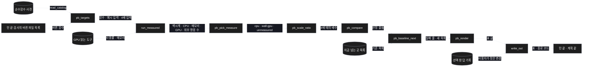
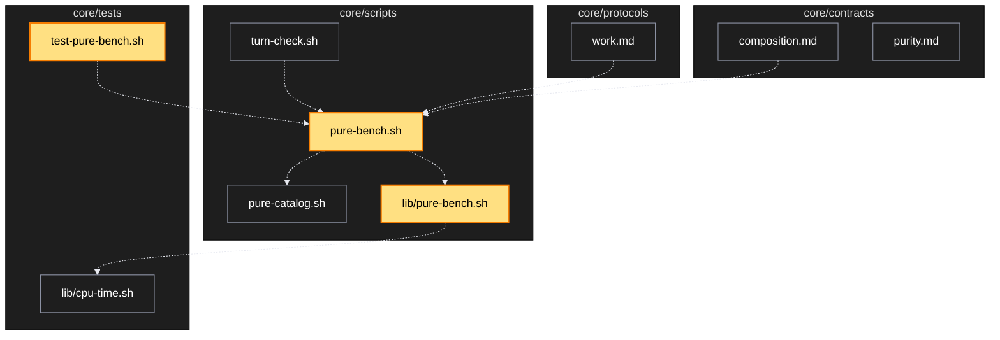

# Architecture — 재는 명령과 느려지면 막기

> 두 그림으로 본 이 계획. **구현 전에 읽고 고칠 것** — 그림은 모델이 그렸다.

## 1. Component data flow



## 2. Position in whole architecture

> Source: scv graph (built 2026-11-11)



## 3. Screen mockups

### 재는 명령의 표

```screen
{
  "title": "재는 명령 — 결과 표",
  "body": [
    { "type": "header", "title": "순수함수 재기", "subtitle": "판정 잣대는 실제로 쓴 것으로 고른다" },
    { "type": "table", "marker": "1", "columns": ["함수", "잣대", "한 번에 드는 값", "메모리 최고", "GPU", "외부 명령 수", "4배 입력"],
      "rows": [
        ["scv_tc_words", { "badge": "cpu", "tone": "muted" }, "0.42ms", "값", "안 씀", "0", { "badge": "12.6배", "tone": "danger" }],
        ["scv_tc_diff", { "badge": "cpu", "tone": "muted" }, "4.6ms", "값", "안 씀", "값", { "badge": "4.4배", "tone": "good" }],
        ["GPU 작업(셸로 띄움)", { "badge": "wall-gpu", "tone": "info" }, "8.3s", "241MB", "92% · 1.1GB", "값", "값"],
        ["GPU 도구가 없는 곳의 GPU 작업", { "badge": "재지 못함", "tone": "warn" }, "값", "값", "재지 못함", "값", "값"]
      ] },
    { "type": "text", "marker": "2", "value": "잰 수 · 못 잰 수와 이유" }
  ],
  "functions": [
    { "marker": "1", "title": "결과 표", "step": "pb_render", "notes": ["숫자는 2026-11-11 에 실제로 잰 값, '값'은 구현 뒤에 채워질 칸"] },
    { "marker": "2", "title": "요약 줄", "step": "pb_render", "notes": ["재지 못한 것은 통과로 세지 않음"] }
  ],
  "validations": { "title": "막는 경우 · 지나가는 경우",
    "columns": ["조건", "결과", "보이는 것"],
    "rows": [
      ["고치기 전보다 한도 넘게 느려짐 · 메모리를 더 씀", "실패", "함수 이름 · 앞뒤 값 · 배수"],
      ["지금 넘는 곳 목록이 늘어남", "실패", "새로 넘은 함수"],
      ["한도를 넘었지만 선택 창 답이 있음", "통과", "답이 계획 기록에 남음"],
      ["GPU 를 썼는데 읽을 도구가 없음", "재지 못함", "통과로 세지 않음"],
      ["순수함수를 안 고친 턴", "돌지 않음", "없음"]
    ] }
}
```
