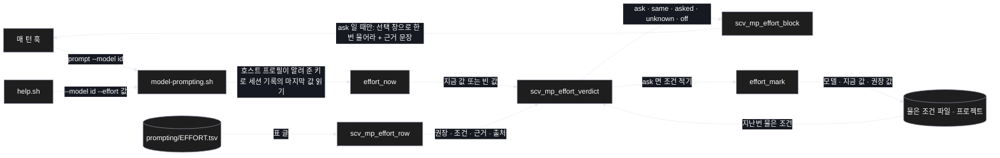
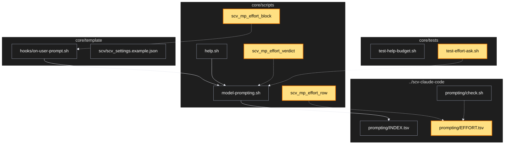

# Architecture — 권장 effort 요청

> 두 그림으로 본 이 계획. **구현 전에 읽고 고칠 것** — 그림은 모델이 그렸다.

## 1. Component data flow



## 2. Position in whole architecture

> Source: scv graph (built 2026-11-11)



## 3. Screen mockups

### 권장 effort 요청

```screen
{
  "title": "권장 effort 요청",
  "diagram": [
    { "label": "구성", "code": "flowchart LR\n  A[\"① 매 턴 안내\"] --> B[\"② 지금 값 읽기\"]\n  A --> C[(\"③ 권장 표\")]\n  B --> D[\"④ 판정\"]\n  C --> D\n  E[(\"⑤ 물은 조건\")] --> D\n  D --> F[\"⑥ 안내 줄\"]" },
    { "label": "순서", "code": "sequenceDiagram\n  autonumber\n  participant H as 매 턴 훅\n  participant M as model-prompting\n  participant S as 물은 조건 파일\n  H->>M: prompt (모델 id)\n  M->>M: 지금 값 · 권장 줄 얻기\n  M->>S: 지난번 물은 조건 읽기\n  alt 다르고 처음\n    M-->>H: 요청 줄 1개\n    M->>S: 조건 적기\n  else 같음 · 이미 물음 · 모름 · 꺼짐\n    M-->>H: 줄 없음\n  end" }
  ],
  "functions": [
    { "marker": "1", "title": "매 턴 안내", "notes": ["요청 줄은 ask 일 때만 실림 — 그 밖의 턴은 0바이트"] },
    { "marker": "2", "title": "지금 값 읽기", "step": "effort_now", "notes": ["받는 값: 호스트 프로필 · 세션 기록 · 도움말 인자", "돌려주는 값: 값 또는 빈 값"] },
    { "marker": "3", "title": "권장 표", "step": "scv_mp_effort_row", "notes": ["한 줄 = 모델 id · 권장 값 · 조건 · 근거 문장 · 출처"] },
    { "marker": "4", "title": "판정", "step": "scv_mp_effort_verdict", "notes": ["받는 값: 스위치 · 지금 값 · 권장 줄 · 지난번 조건", "돌려주는 값: ask · same · asked · unknown · off"] },
    { "marker": "5", "title": "물은 조건(프로젝트)", "step": "effort_mark", "notes": ["물은 조건(모델 · 지금 값 · 권장 값)을 줄로 쌓음 — 새 세션도 다시 묻지 않음"] },
    { "marker": "6", "title": "안내 줄", "step": "scv_mp_effort_block", "notes": ["선택 창으로 한 번 물어라 + 근거 문장", "바꾸는 것은 사용자"] }
  ],
  "statesTitle": "데이터 모양",
  "states": [
    { "marker": "3", "label": "EFFORT.tsv 한 줄", "body": [ { "type": "table", "columns": ["칸", "뜻"], "rows": [["모델 id", "가이드 색인에 있는 id"], ["권장 값", "low · medium · high · xhigh · max"], ["조건", "조건이 달린 모델만, 없으면 -"], ["근거 문장", "공식 문서의 문장 그대로"], ["출처", "공식 문서 주소"]] } ] }
  ],
  "validations": { "title": "묻는 경우 · 묻지 않는 경우",
    "columns": ["번호", "조건", "판정", "요청 줄", "상태 파일"],
    "rows": [
      ["4", "지금 값이 권장과 다르고 처음", "ask", "1개", "조건 적음"],
      ["4", "같은 조건에서 다시", "asked", "0개", "그대로"],
      ["4", "지금 값이 권장과 같음", "same", "0개", "그대로"],
      ["2, 4", "지금 값 모름 · 값 낱말이 아님", "unknown", "0개", "그대로"],
      ["3, 4", "표가 없음 · 표에 없는 모델", "unknown", "0개", "그대로"],
      ["4", "끄는 설정", "off", "0개", "안 생김"],
      ["4", "사람이 없는 실행", "ask 여도 싣지 않음", "0개", "적지 않음"]
    ] }
}
```
