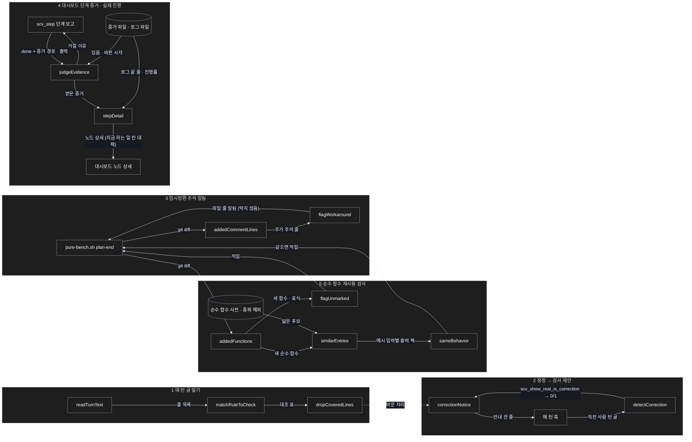
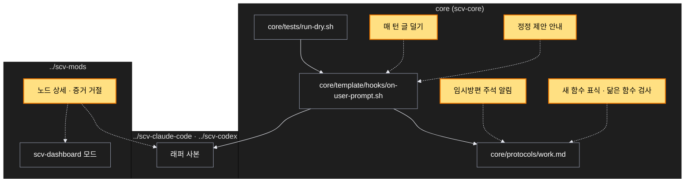

# Architecture — 글 대신 검사

> Two-diagram view of this feature. **Review and edit before `/scv:work`** —
> diagrams are LLM-generated and may have inaccuracies.

## 1. Component data flow

## 2. Position in whole architecture

> Source: scv graph (built 2026-11-17)

