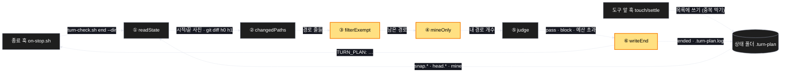
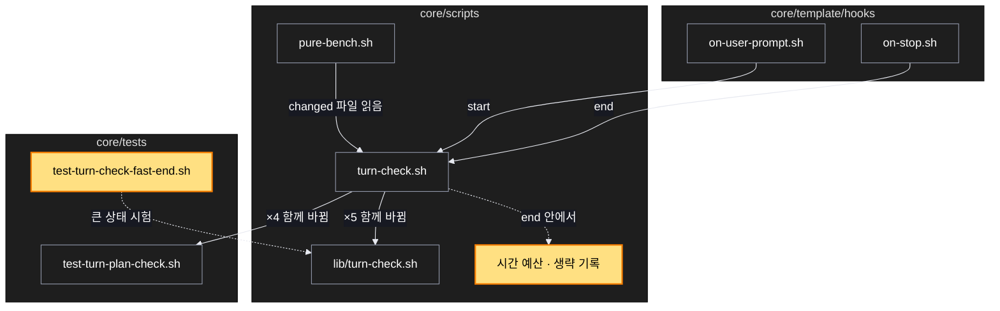

# Architecture — 턴 끝 확인이 멈추지 않게

> Two-diagram view of this feature. **Review and edit before `/scv:work`** —
> diagrams are LLM-generated and may have inaccuracies.

## 1. Component data flow

턴 끝 확인 안에서 경로가 흐르는 길. 노란 칸이 이번에 바꾸는 단계.

## 2. Position in whole architecture

Where this feature sits in the system. New components highlighted in yellow.

> Source: scv graph (built 2026-11-19)

